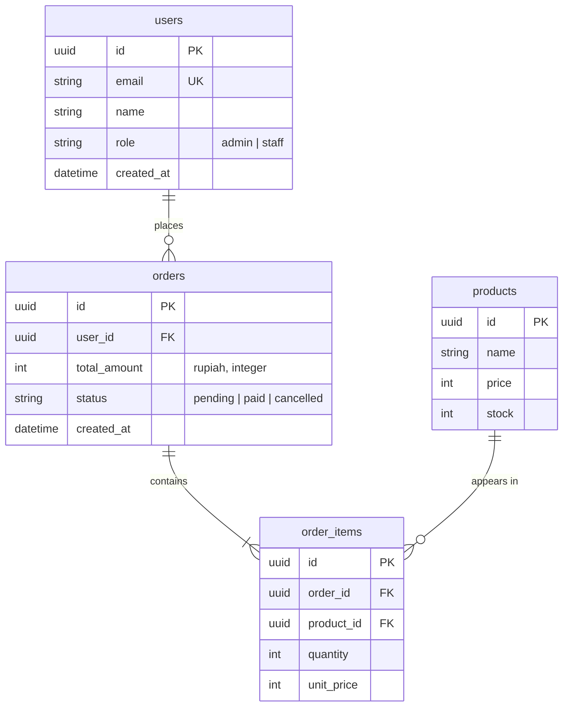

# Database schema — <Project name>

> Human + AI readable schema. The **real** source of truth is the migrations / ORM schema
> (`<e.g. prisma/schema.prisma, drizzle/schema.ts, database/migrations/>`); this file must always match it.
> The mermaid diagram and the DBML block below must describe the SAME tables, columns, and relationships.
> Check: `sh .agents/hooks/db-schema-check.sh` (also runs in pre-commit).

**How to view it visually**
- Mermaid: open this file in Markdown preview (VS Code / Antigravity: `Ctrl+Shift+V`) or on GitHub — the diagram renders.
  If it doesn't render, install a Mermaid preview extension or paste the block into https://mermaid.live.
- DBML: copy the dbml block into https://dbdiagram.io for an interactive diagram (drag tables, export PNG/PDF/SQL).

- **Database:** <PostgreSQL 16 | MySQL | SQLite | ...>
- **ORM / migrations:** <Prisma | Drizzle | Eloquent | SQLAlchemy + Alembic | ...>
- **Naming:** tables plural snake_case, columns snake_case, PK `id`, FK `<singular>_id`, timestamps `created_at`/`updated_at`.

## Diagram (mermaid)



## Schema (DBML)

```dbml
Table users {
  id uuid [pk]
  email varchar [unique, not null]
  name varchar [not null]
  role varchar [not null, default: 'staff', note: 'admin | staff']
  created_at timestamptz [not null, default: `now()`]
}

Table orders {
  id uuid [pk]
  user_id uuid [not null, ref: > users.id]
  total_amount integer [not null, note: 'rupiah, integer']
  status varchar [not null, default: 'pending', note: 'pending | paid | cancelled']
  created_at timestamptz [not null, default: `now()`]

  Indexes {
    (user_id, created_at)
  }
}

Table order_items {
  id uuid [pk]
  order_id uuid [not null, ref: > orders.id]
  product_id uuid [not null, ref: > products.id]
  quantity integer [not null]
  unit_price integer [not null]
}

Table products {
  id uuid [pk]
  name varchar [not null]
  price integer [not null]
  stock integer [not null, default: 0]
}
```

## Notes per table
| Table | Purpose | Important rules |
|---|---|---|
| users | | e.g. email unique, soft delete? |
| orders | | e.g. total stored in integer rupiah; status transitions pending → paid/cancelled |

## Migration log
| Date | Migration | Change | Reversible? |
|---|---|---|---|
| | | | |
