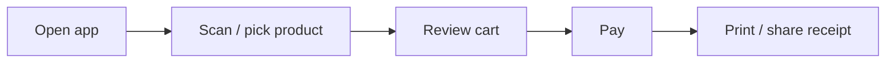

# PRD — <Product name>

> **What** we build and **why**. One lean document that replaces separate BRD / SRS / user-story files.
> Technical "how" lives in `docs/PROJECT.md`. Look & language live in `docs/DESIGN.md`.

- **Last updated:** YYYY-MM-DD
- **Status:** draft | agreed | building | live

## 1. Problem statement
<2–4 sentences: who has what problem, how they deal with it today, why that is painful. No solution yet.>

## 2. Goals & success metrics
| Goal | How we know it worked (measurable) |
|---|---|
| <e.g. Cashier can record a sale fast> | <e.g. A sale with 5 items takes < 30 seconds> |

**Non-goals:** <things this product deliberately will not try to do>

## 3. Target users
| User type | Context (who, where, device, skill level) | Main need |
|---|---|---|
| <e.g. Cashier> | <small shop, Android tablet, not tech-savvy> | <record sales quickly, works offline> |

## 4. Scope
**MVP (v1):**
- <feature>

**Later:**
- <feature>

**Out of scope:**
- <explicitly not doing>

## 5. User stories & acceptance criteria (= functional requirements)
Each story gets an ID. Code, tests, and commits can reference it (`US-03`).

### US-01 — <short title>
As a **<user type>**, I want **<action>**, so that **<benefit>**.
- Given <situation>, when <action>, then <result>.
- Given <unhappy situation>, when <action>, then <result>.
- Priority: must | should | could

### US-02 — <short title>
…

## 6. Non-functional requirements
Only the ones that actually matter for this product, each measurable.
| Area | Requirement |
|---|---|
| Performance | <e.g. pages load < 2 s on 4G; list of 1,000 items scrolls smoothly> |
| Availability / offline | <e.g. sales can be recorded with no internet; sync when online> |
| Security & privacy | <e.g. role-based access; personal data per UU PDP; passwords never stored in plain text> |
| Devices / platforms | <e.g. Android 9+, Chrome/Edge/Safari latest 2 versions, Windows 10+> |
| Accessibility | <e.g. WCAG 2.1 AA contrast, keyboard usable> |
| Localization | <e.g. Indonesian UI, Rupiah format, WIB timezone> |
| Scale | <e.g. 50 stores, 10k transactions/day> |

## 7. Key flows
The main journeys, step by step. Add a diagram only when it makes the flow clearer.

## 8. Assumptions, risks, open questions
- Assumption: <…>
- Risk: <…> → mitigation: <…>
- Open question: <…> (owner, date)
