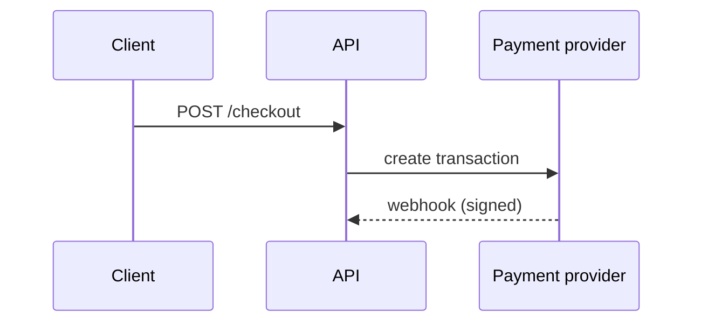

# <Project name> — Technical overview

> The technical "how": stack, architecture, commands, conventions. Keep it accurate.
> Product "what/why": `docs/PRD.md`. Look & language: `docs/DESIGN.md`. Unknowns: write `UNKNOWN — ask user`.

- **Docs language:** English
- **Size tier:** S | M | L
- **Platform(s):**
- **Runs on / hosting:**

## Stack
| Layer | Choice | Why (short) |
|---|---|---|
| Language | | |
| Framework | | |
| Database | | |
| Auth | | |
| Hosting | | |
| Package manager | pnpm (JS/TS) | |
| Key libraries | | |

Full reasoning: `docs/decisions/0001-tech-stack.md`.

## Architecture
**Pattern:** <e.g. modular monolith, feature modules>

**Structure:**
```
<folder tree, 2–3 levels>
```

**Module rules:** <e.g. features import each other only through `features/<name>/index.ts`; shared code in `src/lib`>

**Data model:** full schema with diagram in `docs/DATABASE.md` (mermaid + DBML, kept in sync).

**Important sequences** (only non-obvious ones):


**External services:** <service → wrapper module>

**Security notes:** <where auth happens, roles, sensitive data>

## Commands
| Task | Command |
|---|---|
| Install | |
| Dev / run | |
| Build | |
| Test (unit/integration) | |
| E2E | |
| Lint | |
| Format | |
| **Verify (run before every "done")** | |

## Environment variables
See `.env.example`. <List any that need special setup.>

## Conventions
- <naming, patterns, folder rules specific to this project>

## Tools setup
<!-- Filled after `node .agents/scripts/tools-check.mjs` and ONE question to the user (.agents/knowledge/reading.md
     section 1). The next model reads this instead of asking again. Machine-specific: note which laptop. -->
| Date | Machine | Installed | Refused / not needed | Notes |
|---|---|---|---|---|
| <YYYY-MM-DD> | <laptop name> | <pandoc, pymupdf, python-pptx, docling> | <-> | <installed in background, log in %TEMP%> |
