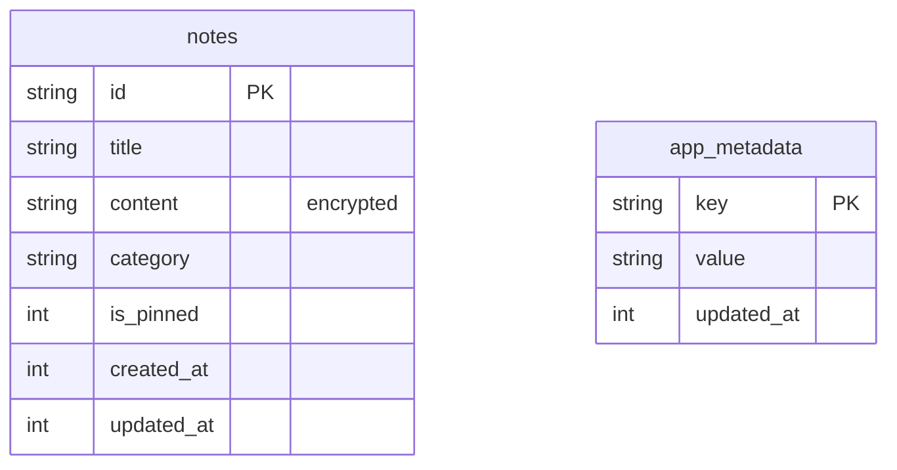

# Database Schema — Offline Vault

> Human + AI readable schema. The **real** source of truth is the SQLite schema migrations in code.
> The mermaid diagram and the DBML block below describe the SAME tables, columns, and relationships.

**How to view it visually**
- Mermaid: open this file in Markdown preview (`Ctrl+Shift+V`) to view the rendered diagram.
- DBML: copy the dbml block into https://dbdiagram.io for an interactive diagram.

- **Database:** SQLite 3 (Offline on-device database)
- **Encryption:** AES-256-GCM encrypted `notes.content`, key from `flutter_secure_storage` (`DataKeyService`). Databases created before ADR 0002 may still contain an unused `credentials` table.
- **Naming:** tables plural snake_case, columns snake_case, PK `id`, timestamps `created_at`/`updated_at`.

## Diagram (mermaid)



## DBML

```dbml
Table notes {
  id varchar [pk]
  title varchar [not null]
  content text [note: 'AES-256-GCM encrypted']
  category varchar [default: 'general']
  is_pinned integer [default: 0]
  created_at integer [not null]
  updated_at integer [not null]
}

Table app_metadata {
  key varchar [pk]
  value text [not null]
  updated_at integer [not null]
}
```

