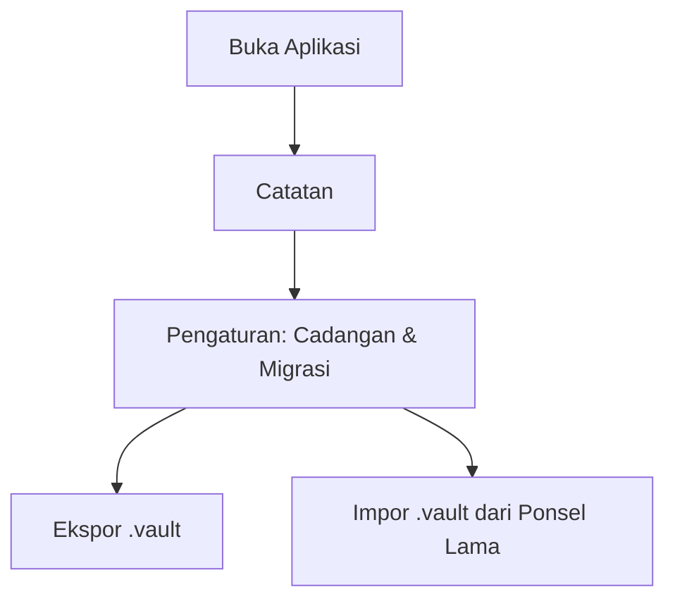

# PRD — Offline Vault

> **What** we build and **why**. One lean document that replaces separate BRD / SRS / user-story files.
> Technical "how" lives in `docs/PROJECT.md`. Look & language live in `docs/DESIGN.md`.

- **Last updated:** 2026-10-30
- **Status:** agreed, revised 2026-10-30 by ADR 0002: notes-only app, no PIN, no Kredensial, backup without password. Sections marked "(dibatalkan)" no longer apply.

## 1. Problem statement
Banyak pengguna memerlukan tempat penyimpanan kredensial sensitif (akun, password, PIN, recovery key) dan catatan pribadi tanpa risiko kebocoran cloud, ketergantungan server pihak ketiga, atau pelacakan telemetri. Ketika berganti perangkat (Android atau iOS), pengguna sering kesulitan memindahkan brankas offline secara aman tanpa harus mengunggah data mereka ke server luar.

## 2. Goals & success metrics
| Goal | How we know it worked (measurable) |
|---|---|
| 100% Offline | Nol permintaan jaringan (zero network permissions / no HTTP endpoints). |
| Keamanan Data Lokal | Seluruh kredensial dan catatan tersimpan terenkripsi (AES-256-GCM / SQLCipher) dengan kunci derivasi master PIN. |
| Migrasi Antar-HP Mulus | Ekspor cadangan terenkripsi ke 1 file tunggal (`.vault`) dan impor kembali di perangkat lain dalam waktu < 5 detik. |
| Performa & Kecepatan | Aplikasi terbuka < 400 ms dan daftar 500 item dapat dicari instan secara lokal. |

**Non-goals:**
- Cloud sync otomatis atau hosting database online (aplikasi ini murni offline-first).
- Kolaborasi multi-user atau sharing realtime antar perangkat lewat server.
- Fitur browser extension otomatis (fokus utama adalah aplikasi mobile mandiri).

## 3. Target users
| User type | Context (who, where, device, skill level) | Main need |
|---|---|---|
| Privacy-conscious user | Pengguna smartphone (Android / iOS) yang mengutamakan privasi dan kedaulatan data lokal | Menyimpan kredensial & catatan tanpa koneksi internet dan bisa dipindahkan saat ganti HP |

## 4. Scope
**MVP (v1, setelah ADR 0002):**
- Catatan Offline: catatan teks dengan judul, isi, kategori yang bisa diedit, `#tag` untuk filter di dalam catatan, dan pencarian cepat. Aplikasi langsung terbuka ke Catatan tanpa PIN.
- Cadangan & Pemulihan: ekspor semua catatan ke satu file `.vault` (JSON biasa, tanpa password) dan impor di HP lain.
- (dibatalkan) Master PIN dan biometrik, Brankas Kredensial, Generator Password, cadangan dengan password.

**Later:**
- TOTP 2FA Authenticator (penyimpan kode OTP offline).
- Secure File/Image Attachment (menyimpan foto KTP/kartu identitas terenkripsi).
- Indikator kekuatan password dan deteksi duplikasi password lokal.

**Out of scope:**
- Sinkronisasi cloud tersentralisasi.
- Fitur autofill browser pihak ketiga yang memerlukan perizinan kompleks sistem operasi pada rilis perdana.

## 5. User stories & acceptance criteria

### US-01 — Setup Master PIN & Buka Kunci Biometrik (dibatalkan, ADR 0002)
As a **pengguna**, I want **mengatur Master PIN saat pertama kali membuka aplikasi dan mengaktifkan biometrik**, so that **data saya aman dari akses fisik yang tidak berhak**.
- Given aplikasi baru dipasang, when dibuka, then sistem meminta membuat Master PIN 6 digit dan konfirmasi.
- Given Master PIN sudah dibuat dan perangkat mendukung biometrik, when login berikutnya, then sistem menawarkan otentikasi biometrik.
- Given salah PIN 5 kali berturut-turut, when percobaan berikutnya, then sistem memberlakukan cooldown 30 detik.
- Priority: must

### US-02 — Manajemen Kredensial & Generator Password (dibatalkan, ADR 0002)
As a **pengguna**, I want **menyimpan detail akun dan menghasilkan password yang kuat**, so that **saya tidak perlu mengingat banyak password rumit**.
- Given form tambah kredensial, when pengguna memasukkan layanan, username, password, then data tersimpan secara terenkripsi di database lokal.
- Given daftar kredensial, when tombol salin ditekan, then password tersalin ke clipboard dan clipboard otomatis dibersihkan dalam 45 detik.
- Given generator password, when pengguna mengatur kriteria (panjang 8-32, simbol, angka), then dihasilkan string acak berentropi tinggi.
- Priority: must

### US-03 — Manajemen Catatan Offline
As a **pengguna**, I want **mencatat informasi penting secara cepat dengan tag/kategori**, so that **semua memo privat saya tertata rapi**.
- Given catatan baru, when disimpan dengan tag tertentu, then catatan muncul di daftar dengan preview singkat.
- Given bilah pencarian, when kata kunci dimasukkan, then sistem memfilter catatan secara realtime berdasarkan judul, isi, atau tag.
- Priority: must

### US-04 — Ekspor & Impor Cadangan Terenkripsi (Migrasi HP)
As a **pengguna yang berganti smartphone**, I want **mengekspor seluruh data ke dalam file cadangan terenkripsi dan mengimpornya di ponsel baru**, so that **saya dapat memindahkan seluruh data tanpa mengunggahnya ke internet**.
- Given opsi ekspor cadangan, when ditekan, then sistem membuat file `.vault` berisi semua catatan dan membuka menu bagikan (tanpa password, ADR 0002).
- Given file cadangan `.vault`, when diimpor di ponsel baru, then seluruh catatan dipulihkan seutuhnya.
- Given file yang bukan cadangan Offline Vault, when diimpor, then sistem menolak file dan data yang ada tidak berubah.
- Priority: must

## 6. Non-functional requirements
| Area | Requirement |
|---|---|
| Performance | Cold start < 400 ms, scrolling 60/120 FPS tanpa frame drop. |
| Availability / offline | 100% offline, tidak membutuhkan izin internet (`android.permission.INTERNET` dihilangkan). |
| Security & privacy | Kredensial terenkripsi lokal menggunakan AES-256-GCM / SQLCipher, Master PIN di-hash dengan PBKDF2/Argon2. |
| Devices / platforms | Android (API level 24+ / Android 7.0+) dan siap untuk iOS (iOS 14+). |
| Localization | Bahasa Indonesia yang jelas dan baku untuk seluruh antarmuka dan pesan kesalahan. |

## 7. Key flows

## 8. Assumptions, risks, open questions
- Assumption: Pengguna bertanggung jawab menjaga keamanan file cadangan dan password cadangannya saat proses transfer file antar-HP.
- Risk: Pengguna lupa Master PIN dan tidak memiliki file cadangan -> mitigasi: beri peringatan tegas di awal bahwa tanpa cloud, Master PIN tidak dapat di-reset oleh pihak manapun.
- Open question: Apakah perlu opsi ekspor plain JSON untuk arsip manual non-enkripsi? (Awalnya diputuskan tidak; diubah 2026-10-30 oleh ADR 0002: ekspor tanpa password atas permintaan pengguna).

