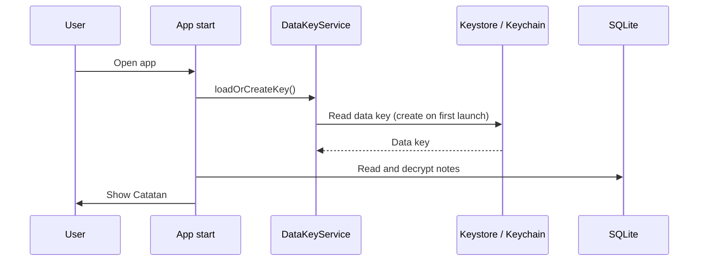

# Offline Vault — Technical Overview

> The technical "how": stack, architecture, commands, conventions. Keep it accurate.
> Product "what/why": `docs/PRD.md`. Look & language: `docs/DESIGN.md`.

- **Docs language:** English
- **Size tier:** S (Small)
- **Platform(s):** Mobile (Android, iOS-ready)
- **Runs on / hosting:** 100% Offline (Local on-device execution)

## Stack
| Layer | Choice | Why (short) |
|---|---|---|
| Language | Dart 3.10+ | Compiled AOT to native machine code, type-safe, null-safe |
| Framework | Flutter 3.38+ | 60/120 FPS native rendering, cross-platform Android & iOS |
| Database / Storage | SQLite + AES-256-GCM | Structured local querying with cryptographic protection |
| Key Management | Android Keystore / iOS Keychain (`flutter_secure_storage`) | Holds the random data key (no PIN, ADR 0002) |
| State Management | `flutter_riverpod` | Predictable, compile-time safe, decoupled dependency injection |
| Key Libraries | `cryptography`, `file_picker`, `share_plus` | Crypto primitives, file handling |

Full reasoning: `docs/decisions/0001-tech-stack.md`.

## Architecture
**Pattern:** Feature-first modular architecture.

**Structure:**
```
lib/
├── core/
│   ├── crypto/            # AES-256-GCM cipher
│   ├── database/          # SQLite helper, schema
│   ├── security/          # DataKeyService: random data key in secure storage
│   └── theme/             # Design system tokens, color schemes
├── features/
│   ├── categories/        # Editable note categories
│   ├── dashboard/         # Bottom navigation: Catatan, Pengaturan
│   ├── notes/             # Notes list, read view with #tag filter, editor
│   ├── backup/            # .vault codec (plain JSON v2) and export/import
│   └── settings/          # Export/import UI
└── main.dart              # App bootstrap, provider scope initialization
```

**Module rules:**
- `core/` contains no feature UI and has zero imports from `features/`.
- `features/` communicate via shared data repositories and Riverpod providers in `core/` or domain models.
- Never write note content to app logs.

**Data model:** full schema with diagram in `docs/DATABASE.md` (mermaid + DBML, kept in sync).

**Important sequences:**


**External services:** Zero external network services. `android.permission.INTERNET` is explicitly removed.

**Security notes:**
- No PIN (ADR 0002). Anyone with the unlocked phone can read the notes; the user accepted this.
- Export files (`.vault`) are plain JSON (`{format, version: 2, exported_at, notes}`) without a password. Version 1 files are rejected.

## Commands
| Task | Command |
|---|---|
| Install | `flutter pub get` |
| Dev / run | `flutter run` |
| Build (Android APK) | `flutter build apk --release` |
| Test (unit/widget) | `flutter test` |
| Lint / Analysis | `flutter analyze` |
| Format check | `dart format --output=none --set-exit-if-changed .` |
| **Verify (run before every "done")** | `flutter analyze && flutter test` |

## Conventions
- Code, comments, commits: English.
- User UI & Messages: Bahasa Indonesia.
- Pure business logic and cryptographic functions must have isolated unit tests.

